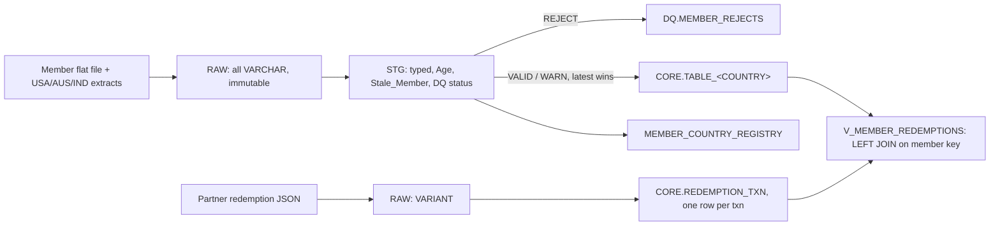

# SkyPoints Loyalty Pipeline



Deliverables: 1 DDL `sql/01` | 2 staging + Age/Stale `sql/02` | 3 country split `sql/03` | 4 JSON + join `sql/04` | 5 validations `sql/05` | 6 demo `docs/DEMO.md`

Splits the daily SkyPoints member flat file into per-country Snowflake tables ("latest record wins"), flattens the
partner JSON redemption feed, and validates both. Built for billions of rows/day.

## Layout
| Path | What |
|---|---|
| `sql/01_ddl.sql` | Deliverable 1: RAW landing, STG staging, CORE country tables, registry, DQ tables |
| `sql/02_load_staging.sql` | Deliverable 2: COPY to RAW, typed staging with **Age** and **Stale_Member** (>90 days) |
| `sql/03_country_split.sql` | Deliverable 3: split by country, latest-wins, handles members who move country |
| `sql/04_redemptions.sql` | Deliverable 4: JSON flatten (`LATERAL FLATTEN`) + join back to members |
| `sql/05_validations.sql` | Deliverable 5: post-load checks |
| `src/skypoints/` | Python reference implementation of the same logic (local run + tests) |
| `tests/` | Unit tests (`python -m unittest discover -s tests`) |

## Architecture
`files -> RAW (all VARCHAR, immutable) -> STG (typed, derived, DQ status) -> CORE.TABLE_<COUNTRY>`; rejects go to `DQ.MEMBER_REJECTS`.

Key decisions
- **Land everything as text.** A bad value must never fail the load; it gets quarantined with a reason code.
- **Latest wins** on `(feed_ts, file_row)`, where `feed_ts` is the extraction time in the file name. Older/replayed files can't overwrite newer data.
- **`MEMBER_COUNTRY_REGISTRY`** (keyed by `member_key`) records each member's current country, so a move touches exactly two tables instead of scanning all of them.
- **Country tables are created dynamically** from a template when a new country first appears. Country codes are normalised through `REF.COUNTRY_MAP`.
- **Idempotent per file** (delete+insert in staging, MERGE in core), so reruns and backfills are safe.
- **Scale:** set-based MERGE, clustering on `member_id`, COPY load history prevents double loads, warehouse sizing for backfills.

## The three real extracts (USA / AUS / IND) are three different layouts
| | USA | AUS | IND |
|---|---|---|---|
| Columns | ID, Name, TierCode, EnrollmentDate, FlightDate | Unique ID, Member Name, Tier Type, Date of Birth, Date of Enrollment, Date of Flight | ID, Name, DOB, TierCode, EnrollmentDate, Individual or Corporate, Flight Date |
| Date style | `6152022`, `12282021` (M/D/Y, no separators, no padding) | `2022-05-11` (ISO) | `1/1/2022` (assumed day-first) |
| Country | not in file, taken from file name | same | same |

Each source has a profile (`REF.SOURCE_PROFILE` in SQL, `PROFILES` in `config.py`) that says how its dates are written, plus
a column mapping to one canonical shape (`RAW.V_MEMBER_CANONICAL`). Adding a country means adding a profile, not new logic.

## Data issues found and how each is handled
1. **IDs are not globally unique.** USA, AUS and IND all number members 1, 2, 3. Latest-wins on the bare ID would merge Sam, Mike and Vikas
   into one person. Extract members get `member_key = '<SRC>-<id>'`; the pipe feed keeps its global Member_Id as the key.
   *Needs confirmation:* does a member who moves country keep the same ID in the extracts? If yes, switch the key to the bare ID.
2. **`########` cells** (DOB and flight dates in IND/AUS, enrollment for IND member 3): Excel's "column too narrow" display; the value
   was lost on export. Optional field -> NULL + warning W08. Mandatory field -> row rejected (E04). Re-export from the source instead of guessing.
3. **Impossible date:** AUS member 2 enrolled `2021-13-13`. Mandatory field -> rejected with E04.
4. **Ambiguous dates:** USA `1052022` / `1152022` could be 1/05 or 10/5 (7 digits, no separators). First reading taken, flagged W12.
   `6152022` and `8202022` have only one valid reading. IND `3/5/2022` is read as 3 May (day-first); confirm with the sender.
5. **`NULL` strings** (AUS DOB) are treated as missing, not as errors.
6. **Different headers** for the same field (`Mem_Id`, `Unique ID`, `ID`; `Tier Type`, `TierCode`) -> canonical names.
7. **Optional vs mandatory:** a bad DOB or flight date never throws away a member; it nulls the value and warns. Bad name/ID/enrollment/country rejects the row to `DQ.MEMBER_REJECTS`.
8. Extra IND field (`Individual or Corporate`) is kept as `member_type` (I/C); other sources leave it NULL.
9. Spec marks **Member Name** as the key column; names are not unique, so the key is Member_Id (member_key). To confirm.
10. Pipe-feed issues from the PDF: mixed country codes (USA/US/AU/AUS/PHIL -> ISO-2), DOB leading zero lost (`3051985`, padded; DDMMYYYY assumed),
    4-5 digit IDs (W05), Post Code in spec table but not layout (VARCHAR, so leading zeros survive).
11. Every sample member's last flight is in 2022 or earlier, so all are `Stale_Member` as of the feed date: expected.

## Assumptions
- Pipe feed name `SKYPOINTS_MEMBERS_YYYYMMDD_HHMMSSTT.dat`; extracts named `USA`, `AUS`, `IND` (`.csv`/`.xlsx`) with no date, so
  the extraction time falls back to file modification time (SQL: `P_FEED_TS`).
- Age and Stale_Member are computed as of the feed date (override with `--as-of`). No flight on record counts as stale.
- Tier codes GLD/SLV/PLT/BRZ and Is_Active A/I are configurable; unexpected values warn.
- Only COMPLETED redemptions count toward balances; the partner feed joins on the global Member_Id only.

## Run locally
```
PYTHONPATH=src python -m skypoints.cli --input data/sample --out out --as-of 2024-01-15
python -m unittest discover -s tests
```

## What is not done / next steps
- The SQL is written for Snowflake but I have not been able to run it against a live account; the Python reference implementation
  (same rules) is what the tests exercise. First job on an account: run `sql/01` to `05` against the sample files and compare to `make run`.
- `.xlsx` extracts are read directly by the Python path; the Snowflake path expects them converted to CSV upstream.
- Orchestration (Snowpipe/Tasks or Airflow), alerting on DQ thresholds, and a volume-anomaly check are described, not built.

## How AI was used
The assignment asks for AI, so here is what I did with it. I used Claude to draft the DDL, stored procedures, the Python reference
implementation and the tests, and to talk through design options. I made the decisions that matter and checked the output against the spec and the
real files: using Member_Id (not Member Name) as the key, a registry table for country moves, namespacing the IDs of the country extracts
after noticing they all start at 1, rejecting only on mandatory fields, and keeping ambiguous dates visible instead of guessing.
Where a decision rests on an assumption I could not confirm, it is listed above.
